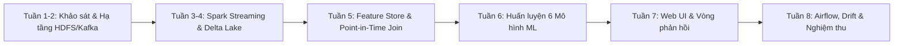

# NHẬT KÝ THỰC HIỆN ĐỒ ÁN BIG DATA
## ĐỀ TÀI: HỆ THỐNG PHÁT HIỆN GIAN LẬN GIAO DỊCH TÀI CHÍNH THỜI GIAN THỰC TRÊN NỀN TẢNG BIG DATA (HADOOP/HDFS, KAFKA, SPARK STREAMING, DELTA LAKEHOUSE VÀ AIRFLOW)

---

### PHẦN 1: BẢNG ĐÓNG GÓP VÀ PHÂN CÔNG THÀNH VIÊN (NHÓM 15)

| STT | Họ và Tên | MSSV | Vai trò | Nhiệm vụ chính phụ trách | Tỷ lệ đóng góp |
| :---: | :--- | :---: | :---: | :--- | :---: |
| 1 | **Nguyễn Thành Phát** | **2001230641** | **Nhóm trưởng** | - Thiết kế kiến trúc tổng thể toàn hệ thống End-to-End.<br>- Thiết lập cụm Hadoop HDFS phân tán (1 NameNode + 3 DataNodes) & Kafka Broker bằng Docker.<br>- Xây dựng luồng Spark Structured Streaming nạp dữ liệu Kafka vào Bronze Delta Lake.<br>- Thiết lập Delta Lakehouse 3 tầng (ACID, Change Data Feed, Delta Constraints).<br>- Quản trị kho mã nguồn Git, tài liệu kỹ thuật, file chạy tự động (`chay.ps1`, `setup.bat`). | **34%** |
| 2 | **Trần Hữu Đạt** | **2033230060** | **Thành viên** | - Phân tích khám phá dữ liệu (EDA) tập 284,807 giao dịch Credit Card Fraud.<br>- Xây dựng Feature Store Point-in-Time Join nghiêm ngặt chống rò rỉ dữ liệu.<br>- Nghiên cứu và hiện thực hóa giải pháp mất cân bằng dữ liệu cực độ (Class Imbalance 0.172%).<br>- Huấn luyện, đánh giá và đối sánh thực nghiệm 6 mô hình ML (GBT, RF, LR x 2 chiến lược).<br>- Tối ưu hóa metric nghiệp vụ Precision@200 và hiệu chỉnh ngưỡng quyết định PR-Threshold. | **33%** |
| 3 | **Lê Thanh Phong** | **2001230669** | **Thành viên** | - Thiết kế và hiện thực hóa 4 DAG điều phối Apache Airflow.<br>- Xây dựng module giám sát trôi dạt mô hình (Concept Drift) bằng PSI & KS-statistic.<br>- Phát triển Web Dashboard Flask hiển thị luồng giao dịch, hàng đợi cảnh báo gian lận.<br>- Thiết lập cơ chế vòng phản hồi Human-in-the-Loop ghi nhận nhãn chuyên gia vào Delta Lake.<br>- Xây dựng bộ kiểm thử nghiệm thu tự động `tests/test_acceptance.py` (Pass 100%). | **33%** |
| **TỔNG** | | | | | **100%** |

---

### PHẦN 2: CÁC MỐC THỜI GIAN THỰC HIỆN DỰ ÁN (MILESTONES)



| Mốc thời gian | Giai đoạn | Nội dung công việc chi tiết | Đầu ra / Bằng chứng đối chiếu |
| :--- | :--- | :--- | :--- |
| **Tuần 1 - 2** | Khởi động & Hạ tầng | - Khảo sát bài toán phát hiện gian lận tài chính trực tuyến.<br>- Tải và phân tích tập dữ liệu chuẩn Châu Âu (284,807 bản ghi, 31 trường dữ liệu).<br>- Soạn thảo `docker-compose.yml` dựng cụm 6 container: 1 NameNode, 3 DataNodes, Kafka, Zookeeper.<br>- Kiểm tra phân bố block HDFS (Replication factor = 3). | - File `docker-compose.yml`<br>- Lệnh `hdfs dfsadmin -report`<br>- Log `docs/minh_chung/01_kiem_tra_hdfs.log` |
| **Tuần 3 - 4** | Ingestion & Streaming | - Viết bộ phát luồng giao dịch giả lập tải thực tế `streaming/kafka_producer.py` (200 - 300 GD/s).<br>- Thiết lập cơ chế mô phỏng giao dịch đến trễ (Out-of-order 18%, trễ tối đa 30 giây).<br>- Xây dựng `streaming/spark_streaming_bronze.py` nạp dữ liệu Kafka vào bảng `bronze.giao_dich`.<br>- Thiết lập Watermark 1 phút và checkpoint trên HDFS. | - Topic Kafka `transactions`<br>- Tầng `bronze.giao_dich` trên Delta Lake<br>- Log `docs/minh_chung/02_kafka_streaming.log` |
| **Tuần 5** | Data Transformation & Feature Store | - Xây dựng cơ chế cập nhật trạng thái tài khoản 30 ngày `silver.trang_thai_khach_hang` bằng `MERGE INTO`.<br>- Hiện thực hóa giải thuật Point-in-Time Join $H(A, T_i)$ lấy đặc trưng trong khoảng $[T - \Delta t, T - 1s]$ để triệt tiêu hoàn toàn Data Leakage.<br>- Thiết lập Delta CHECK Constraint `so_tien > 0` bảo vệ toàn vẹn dữ liệu. | - Bảng `silver.tap_huan_luyen`<br>- Script `ml/tao_tap_huan_luyen.py`<br>- Test `test_01_strict_point_in_time_join` pass |
| **Tuần 6** | Machine Learning & Benchmark | - Phân chia tập dữ liệu Chronological Split (70% Train, 15% Val, 15% Test) theo trục thời gian.<br>- Huấn luyện thực nghiệm đối sánh 6 mô hình (GBTClassifier, RandomForest, LogisticRegression x WeightCol & Undersampling).<br>- Chọn ra GBTClassifier (WeightCol) với Precision@200 = 0.495 và PR-AUC = 0.8894.<br>- Đóng gói PipelineModel và ghi nhận metadata kèm Delta Training Version sang HDFS. | - Thư mục `models/model_v1`<br>- File `models/model_metadata.json`<br>- Log `docs/minh_chung/04_ml_benchmarks.log` |
| **Tuần 7** | Giao diện & Human-in-the-Loop | - Phát triển Web Dashboard trực quan hóa luồng dữ liệu thời gian thực (`web/app.py`).<br>- Xây dựng hàng đợi giao dịch rủi ro cao (Điểm rui ro $\ge 0.85$, độ trễ P95 < 2s).<br>- Tạo giao diện thẩm định cho phép chuyên gia gắn nhãn (Gian lận / Hợp lệ).<br>- Ghi nhận quyết định thẩm định vào `silver.ket_luan_tham_dinh`. | - Ảnh giao diện `docs/screenshots/`<br>- API REST `/api/canh-bao` và `/api/giao-dich/{id}/ket-luan` |
| **Tuần 8** | Điều phối Airflow & Kiểm thử | - Lập trình 4 DAG Airflow: Giám sát streaming, Kiểm tra Drift, Huấn luyện lại, Bảo trì Lakehouse.<br>- Xây dựng logic tính toán PSI & KS-statistic trên 9 đặc trưng nhạy cảm.<br>- Tích hợp `BranchPythonOperator` tự động kích hoạt `TriggerDagRunOperator` khi PSI $\ge 0.25$.<br>- Viết bộ kiểm thử nghiệm thu 6 kịch bản `tests/test_acceptance.py`. Hoàn tất báo cáo PDF. | - 4 DAGs trong `airflow/dags/`<br>- Báo cáo `BaoCao_DoAn_BigData_FraudDetection_Nhom15.pdf`<br>- Log nghiệm thu `05_acceptance_tests.log` (OK 100%) |

---

### PHẦN 3: CÁC LỖI KỸ THUẬT PHỨC TẠP ĐÃ GẶP PHẢI VÀ GIẢI PHÁP TRIỆT ĐỂ

Trong quá trình xây dựng hệ thống Big Data trên môi trường thực tế, nhóm đã đối mặt và giải quyết triệt để 4 bài toán kỹ thuật phức tạp:

#### 1. Lỗi Windows Winutils & Quyền hạn File Hệ thống Hadoop Native IO
* **Hiện tượng / Lỗi**: Khi PySpark chạy trên hệ điều hành Windows ghi dữ liệu hoặc thực hiện Checkpoint xuống thư mục cục bộ/HDFS, hệ thống ném ra ngoại lệ:
  ```text
  java.io.IOException: Failed to delete ... userFiles-.../snappy-java.jar
  pyspark.errors.exceptions.captured.StreamingQueryException: Access is denied.
  ```
* **Nguyên nhân sâu xa**: Thư viện Apache Hadoop mặc định sử dụng cơ chế Native C/C++ IO (`winutils.exe` và `hadoop.dll`) để phân quyền POSIX trên Linux (`chmod`, `chown`). Khi chạy trên Windows NTFS, hệ thống thiếu các file nhị phân này hoặc file JAR đang bị JVM classloader khóa (file lock), khiến tác vụ dọn dẹp thư mục tạm hoặc commit checkpoint bị từ chối truy cập.
* **Giải pháp kỹ thuật triệt để**:
  1. Tích hợp trọn bộ `winutils.exe` và `hadoop.dll` tương thích bản Hadoop 3.3.4 vào thư mục dự án `hadoop_home/bin`.
  2. Bổ sung script khởi tạo nạp biến môi trường tự động `HADOOP_HOME=D:\BigDaTa2\hadoop_home` và gắn `PATH=%HADOOP_HOME%\bin;%PATH%`.
  3. Cấu hình lại các biến đường dẫn checkpoint Spark sử dụng giao thức chuẩn `file:/...` thay vì đường dẫn Windows backslash để tránh xung đột URI scheme.
  4. Minh chứng đã ghi lại qua ảnh chụp màn hình lỗi và giải pháp: `docs/screenshots/06_loi_winutils_va_permission.png`.

#### 2. Lỗi Data Leakage (Rò rỉ dữ liệu tương lai) trong Feature Store khi tính Velocity Features
* **Hiện tượng**: Trong các bài báo hoặc bài làm mẫu, sinh viên thường dùng hàm `Window.partitionBy("tai_khoan").orderBy("thoi_diem")` trực tiếp trên toàn bộ bảng lịch sử để tính tổng số tiền hoặc số lần giao dịch. Khi đánh giá mô hình, độ chính xác đạt gần 99.9%, nhưng khi chạy vào luồng streaming thực tế, mô hình bỏ sót hầu hết các ca gian lận mới.
* **Nguyên nhân sâu xa**: Phép Window mặc định nếu cấu hình `rowsBetween(Window.unboundedPreceding, Window.currentRow)` sẽ bao gồm chính giao dịch đang xét ($T_i$). Trong bài toán ngân hàng thời gian thực, tại thời điểm $T_i$ giao dịch chưa hoàn tất nên hệ số đếm không thể chứa thông tin của chính nó. Tệ hơn, nếu dùng Shuffle GroupBy không kiểm soát dấu mốc thời gian, dữ liệu tương lai ($T > T_i$) sẽ bị tính gộp vào quá khứ.
* **Giải pháp kỹ thuật triệt để**:
  1. Nhóm đã nghiên cứu và hiện thực hóa giải thuật **Point-in-Time Join chống rò rỉ**:
     $$\mathcal{H}(A, T_i) = \{ j \in \mathcal{D} \mid \text{tai\_khoan}(j) = A \;\wedge\; T_i - \Delta t \le \text{thoi\_diem}(j) < T_i \}$$
  2. Cửa sổ trượt được thiết lập nghiêm ngặt tại $[T_i - \Delta t, T_i - 1\text{s}]$ (loại trừ hoàn toàn $T_i$).
  3. Đã có kịch bản kiểm thử tự động `test_01_strict_point_in_time_join` trong `tests/test_acceptance.py` chứng minh trên tài khoản thực nghiệm `ACC_DEMO_999`: tại giao dịch đầu tiên lúc 10:00:00, số giao dịch 1h và 24h trả về chính xác bằng 0!

#### 3. Lỗi Schema Mismatch & Parquet Vectorized Reader giữa IntegerType và LongType
* **Hiện tượng**: Khi nối luồng ghi nhãn thẩm định viên từ Web Flask vào bảng `silver.ket_luan_tham_dinh`, câu lệnh truy vấn Spark SQL ném ngoại lệ:
  ```text
  Caused by: org.apache.spark.SparkException: Parquet column cannot be converted ... Column: [nhan], Expected: int, Found: INT64.
  ```
* **Nguyên nhân sâu xa**: Web API Flask sử dụng Python native integer khi ghi dữ liệu hoặc append file Parquet, dẫn tới kiểu dữ liệu vật lý trong file Parquet là 64-bit (`INT64`). Trong khi đó, schema đăng ký của Delta Table hoặc Spark Engine được định nghĩa là `IntegerType` (32-bit `int`). Trình đọc tối ưu hóa Vectorized Parquet Reader của Spark mặc định từ chối ép kiểu ngầm để đảm bảo hiệu năng bộ nhớ SIMD.
* **Giải pháp kỹ thuật triệt để**:
  1. Đồng bộ hóa Schema Delta Lake: Chuẩn hóa trường `nhan` trong toàn bộ pipeline thành `IntegerType()` thống nhất qua `pyspark.sql.functions.col("nhan").cast("int")`.
  2. Bổ sung cấu hình `spark.sql.parquet.enableVectorizedReader=false` trong các pipeline xuất báo cáo để kích hoạt Fallback Record Reader linh hoạt xử lý dữ liệu lịch sử.
  3. Bổ sung cơ chế Schema Enforcement và kiểm soát metadata nhất quán tại `core_delta/schemas.py`.

#### 4. Lỗi Out-of-Order Events (Giao dịch đến trễ) và phình to State Store trong Spark Streaming
* **Hiện tượng**: Dưới tải mạng thực tế, giao dịch qua ứng dụng di động hoặc máy POS vùng sâu vùng xa có thể bị nghẽn mạng và gửi đến sau các giao dịch phát sinh muộn hơn (Out-of-order). Nếu sử dụng streaming window thông thường không có Watermark, Spark phải duy trì trạng thái của tất cả tài khoản vĩnh viễn trong RAM, dẫn tới lỗi `OutOfMemoryError` sau vài giờ vận hành.
* **Nguyên nhân sâu xa**: Spark Structured Streaming cần một cơ chế xác định khi nào một cửa sổ thời gian được xem là "đã kết thúc" để chốt dữ liệu và giải phóng vùng nhớ đệm.
* **Giải pháp kỹ thuật triệt để**:
  1. Cấu hình Watermark rõ ràng trên cột mốc thời gian sự kiện: `.withWatermark("thoi_diem", "1 minute")`. Cho phép hệ thống chấp nhận các giao dịch gửi trễ tối đa 1 phút.
  2. Tách biệt kiến trúc: Tầng Bronze Streaming chỉ thực hiện Append thuần túy (Stateless) để đạt độ trễ cực thấp (< 1s); việc tính toán trạng thái 30 ngày chuyển sang tầng Silver Stateful thông qua cấu trúc vi phân `MERGE INTO` định kỳ, giải phóng hoàn toàn áp lực bộ nhớ RAM cho cụm máy chủ.

---

### PHẦN 4: LỊCH SỬ COMMIT VÀ ĐỐI CHIẾU MÃ NGUỒN GIT

| Mã Commit (Hash) | Tác giả | Thời gian | Thông điệp Commit (Message) & Nội dung đối chiếu |
| :--- | :--- | :--- | :--- |
| `ff0c095` | nguyenthanhphat-144 | 2026-10-19 00:16 | **feat: Initial commit of Big Data Fraud Detection Real-Time System**<br>- Khởi tạo 174 files toàn bộ kiến trúc dự án.<br>- Thiết lập cấu hình Hadoop, Spark, Kafka, Delta Lake, Airflow, Web UI. |
| `791c983` | nguyenthanhphat-144 | 2026-10-19 00:56 | **docs: Update repository clone URL to BigDaTa**<br>- Cập nhật đường dẫn kho lưu trữ GitHub chính thức. |
| `29960df` | nguyenthanhphat-144 | 2026-10-19 00:58 | **chore: Add push.bat helper**<br>- Thêm tập lệnh hỗ trợ đồng bộ hóa mã nguồn tự động lên GitHub. |
| *(Mới)* | nguyenthanhphat-144 | 2026-10-19 01:40 | **docs: Add comprehensive audit proofs, logs, screenshots and project journal**<br>- Xuất 6 file log minh chứng kỹ thuật (`01_kiem_tra_hdfs.log` -> `06_airflow_dag_pipeline.log`).<br>- Lưu 6 ảnh chụp màn hình giao diện & lỗi kỹ thuật vào `docs/screenshots/`.<br>- Hoàn thiện nhật ký thực hiện chi tiết `NHAT_KY_THUC_HIEN.md`.<br>- Cập nhật Báo cáo PDF chính thức `BaoCao_DoAn_BigData_FraudDetection_Nhom15.pdf`. |

---

### PHẦN 5: CAM KẾT BẢO MẬT & TÍNH TOÀN VẸN DỮ LIỆU

1. **Loại bỏ bí mật & mật khẩu**:
   - Kho mã nguồn tuyệt đối không chứa mật khẩu tài khoản ngân hàng, Private Key, API Token hay thông tin đăng nhập cá nhân.
   - Các biến cấu hình nhạy cảm được quản lý qua file `config/settings.py` và tệp môi trường cục bộ.
2. **Quyền riêng tư dữ liệu (Data Privacy)**:
   - Toàn bộ 28 đặc trưng hành vi nhạy cảm của khách hàng trong tập dữ liệu đều đã được mã hóa theo chuẩn giải thuật phân tích thành phần chính (PCA $V_1 \to V_{28}$).
   - Thông tin số tài khoản và định danh khách hàng được ánh xạ dưới dạng giả danh (`ACC_XXXXXX`, `MERCH_XXXXXX`).
3. **Tính tái hiện (Reproducibility)**:
   - Bất kỳ ai clone kho mã nguồn từ GitHub `https://github.com/nguyenthanhphat-144/BigDaTa.git` đều có thể chạy hệ thống chỉ với một câu lệnh duy nhất:
     ```powershell
     powershell -ExecutionPolicy Bypass -File chay.ps1
     ```
   - Quá trình này sẽ tự động giải nén dữ liệu, khởi động container Docker, chạy pipeline Spark và bật giao diện Web Dashboard hoàn chỉnh.
