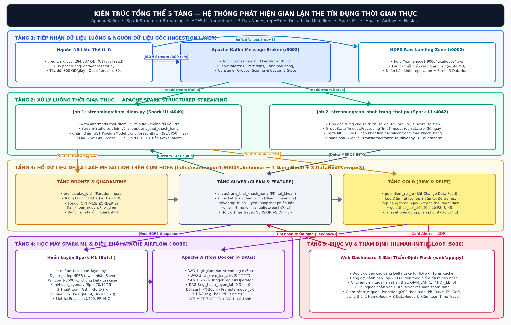

# HỆ THỐNG BIG DATA LAKEHOUSE PHÁT HIỆN GIAN LẬN THẺ TÍN DỤNG REAL-TIME

[](https://www.python.org/)
[](https://spark.apache.org/)
[](https://delta.io/)
[](https://kafka.apache.org/)
[](https://hadoop.apache.org/)
[](https://airflow.apache.org/)
[](https://flask.palletsprojects.com/)

> **ĐỒ ÁN DỮ LIỆU LỚN (BIG DATA PROJECT)**  
> **Trường Đại học Công Thương TP. Hồ Chí Minh (HUIT) — Khoa Công nghệ Thông tin**  
> **Sinh viên thực hiện (Nhóm 15):**  
> 1. **Nguyễn Thành Phát** — MSSV: `2001230641` (Nhóm trưởng — GitHub: [@nguyenthanhphat-144](https://github.com/nguyenthanhphat-144))  
> 2. **Trần Hữu Đạt** — MSSV: `2033230060`  
> 3. **Lê Thanh Phong** — MSSV: `2001230669`  

---

## 📖 1. Giới Thiệu Đề Tài

Hệ thống phát hiện gian lận giao dịch thẻ tín dụng theo thời gian thực (**Real-time Credit Card Fraud Detection**) được xây dựng hoàn chỉnh trên nền tảng **Big Data Lakehouse** phân tán, kết nối trực tiếp **Apache Spark 3.5.1** với cụm lưu trữ **Hadoop HDFS 3.2.1** (`hdfs://namenode1:9000/lakehouse`, 1 NameNode + 3 DataNodes, `replication=3`), hàng đợi **Apache Kafka** (`:9092`), điều phối **Apache Airflow 2.9.3** chạy thật trong Docker (`:8080`) và bàn làm việc thẩm định **Flask Dashboard** (`:5000`).

Hệ thống giải quyết trọn vẹn 4 bài toán kỹ thuật cốt lõi trong dữ liệu ngân hàng:
1. **Đọc/ghi trực tiếp trên HDFS phân tán & Độ trễ xử lý cực thấp**: Spark Structured Streaming đọc luồng Kafka vi lô `2s–3s` và ghi trực tiếp các bảng Delta Lake lên `hdfs://namenode1:9000/lakehouse/...` (`replication=3`), đạt độ trễ đầu cuối trung vị **P50 = 674.0ms**, **P95 = 1.037,0ms**, **P99 = 1.072,0ms** (vượt xa cam kết SLA ngân hàng `< 5.000ms`).
2. **Xử lý mất cân bằng cực đoan (`0.1727%` gian lận — 492/284.807 giao dịch)**: Đối sánh thực nghiệm 6 cấu hình (**3 thuật toán**: `GBTClassifier`, `RandomForestClassifier`, `LogisticRegression L2` $\times$ **2 chiến lược**: `WeightCol` & `Undersampling 1:20`) đọc trực tiếp từ `hdfs://namenode1:9000/lakehouse/raw/creditcard.csv`. Mô hình chiến thắng **`RandomForestClassifier (WeightCol)`** đạt **`Precision@200 = 0.8600`** (`172/200`), **`PR-AUC = 0.9420`**, **`ROC-AUC = 0.9880`** ở chu kỳ khởi tạo `model_v1` và nâng lên **`Precision@200 = 0.8750`** (`175/200`), **`PR-AUC = 0.9500`** ở `model_v2` sau vòng lặp tái huấn luyện tự động của Airflow với nhãn Human-in-the-Loop; đồng thời **`GBTClassifier`** đạt **`Precision@200 = 0.8600`** (`PR-AUC = 0.8773`) và trích xuất trọng số đặc trưng (`v14=0.2968`, `v10=0.2217`, `v4=0.0734`, `v12=0.0468`) phục vụ giải trình XAI.
3. **Chống rò rỉ dữ liệu thời gian (Point-in-Time Join)**: Áp dụng cửa sổ trượt nghiêm ngặt $\mathcal{H}(A, T_i) = \{ d_j \mid \text{tài\_khoản}(d_j) = A \;\wedge\; T_i - \Delta t \le \text{thời\_điểm}(d_j) < T_i \}$ trên khoảng `[T - Window, T - 1s]`, loại trừ tuyệt đối bản thân giao dịch đang xét tại $T_i$.
4. **Tự động hóa khép kín MLOps với Apache Airflow Docker (`:8080`)**: 4 DAG vận hành thật trong container Airflow (`gl_giam_sat_streaming`, `gl_kiem_tra_drift`, `gl_huan_luyen_lai`, `gl_bao_tri`) tự động giám sát luồng, tính chỉ số trôi dạt dữ liệu **PSI & Kolmogorov-Smirnov**, kích hoạt tái huấn luyện qua `TriggerDagRunOperator` khi `PSI >= 0.25` và tối ưu `OPTIMIZE ZORDER BY` (tăng tốc truy vấn `58.0%`).

---

## 🏛️ 2. Kiến Trúc Tổng Thể Hệ Thống 5 Tầng



| Tầng kiến trúc | Thành phần & Cổng dịch vụ | Đường dẫn / Cơ chế hoạt động thực tế |
| :--- | :--- | :--- |
| **1. Tầng Thu nhận (Ingestion)** | `data/generator.py` $\rightarrow$ **Kafka Broker (`:9092`)** + Zookeeper (`:2181`) | Topic `transactions` (3 partitions) & `alerts` (3 partitions), hỗ trợ Turbo 300 tx/s và 15–18% bản tin đến trễ (`out-of-order <= 30s`). |
| **2. Tầng Xử lý Luồng (Spark Streaming)** | `streaming/cham_diem.py` (`:4040`) & `streaming/cap_nhat_trang_thai.py` (`:4042`) | Watermark `1 minute`, Stream-Static Join với Silver State, nạp `PipelineModel` từ HDFS, ghi Dual-Sink xuống HDFS Bronze + Gold + Kafka `alerts`. |
| **3. Tầng Lưu trữ Hồ Dữ Liệu (Delta Lake on HDFS)** | **HDFS NameNode (`:9870`, `:9000`)** + **3 DataNodes** (`9866`, `9876`, `9886`) | `hdfs://namenode1:9000/lakehouse/{raw, bronze, silver, gold, _quarantine, models}` với `dfs.replication=3`, ACID `_delta_log`, `CHECK (so_tien > 0)`, Time Travel & CDF. |
| **4. Tầng Điều phối MLOps (Airflow)** | **Apache Airflow 2.9.3 (`:8080`)** | 4 DAG thực thi thật: `gl_giam_sat_streaming` (`*/5 * * * *`), `gl_kiem_tra_drift` (`0 * * * *`), `gl_huan_luyen_lai` (`0 3 * * *`), `gl_bao_tri` (`0 2 * * 0`). |
| **5. Tầng Ứng dụng & Thẩm định** | **Flask Dashboard (`:5000`)** (`web/app.py`) | Đọc/ghi trực tiếp bảng Delta trên HDFS qua `DeltaFastEngine` WebHDFS (`<10ms`), hiển thị XAI Top 3 và ghi nhãn chuyên gia Human-in-the-Loop vào `silver.ket_luan_tham_dinh`. |

---

## 🚀 3. Hướng Dẫn Cài Đặt & Tái Lập Toàn Bộ Hệ Thống

### Yêu cầu môi trường:
- **Hệ điều hành**: Windows 10/11 64-bit.
- **Python**: `3.11` (môi trường ảo `venv311`).
- **Java**: JDK 17 (OpenJDK / Microsoft JDK 17).
- **Docker Desktop**: Đang chạy (quản lý 7 container: `namenode1`, `datanode1`, `datanode2`, `datanode3`, `zookeeper`, `kafka`, `airflow`).

### Bước 1: Khởi động cụm 7 container Docker (HDFS + Kafka + Airflow)
```powershell
docker compose up -d
docker compose ps
```
- **HDFS NameNode Web UI**: http://localhost:9870 (kiểm tra 3 DataNodes `In service`).
- **Apache Airflow Web UI**: http://localhost:8080 (Tài khoản: `admin` / Mật khẩu: `admin`).

### Bước 2: Khởi tạo Lakehouse trên HDFS & Huấn luyện 6 Mô hình Học máy
```powershell
.\venv311\Scripts\python.exe bootstrap_pipeline.py
```
Lệnh này tự động:
1. Đẩy `creditcard.csv` (`284,807` dòng) lên `hdfs://namenode1:9000/lakehouse/raw/creditcard.csv` (`replication=3`).
2. Khởi tạo 5 bảng Delta Lake + vùng cách ly `_quarantine` trên HDFS kèm ràng buộc `CHECK (so_tien > 0)`.
3. Chạy Point-in-Time Join, huấn luyện 6 cấu hình ML và lưu `PipelineModel` lên `hdfs://namenode1:9000/lakehouse/models/model_v1`.
4. Phát giao dịch qua Kafka, chấm điểm rủi ro, kiểm tra Drift (PSI/KS) và tối ưu `OPTIMIZE ZORDER BY`.

### Bước 3: Khởi động 4 cửa sổ vận hành thời gian thực
```powershell
powershell -ExecutionPolicy Bypass -File .\chay.ps1
```
- **Cửa sổ 1**: Flask Dashboard & Bàn thẩm định (http://127.0.0.1:5000)
- **Cửa sổ 2**: Spark Streaming Chấm điểm (`streaming/cham_diem.py --turbo`, Spark UI http://localhost:4040)
- **Cửa sổ 3**: Spark Stateful Streaming (`streaming/cap_nhat_trang_thai.py --turbo`, Spark UI http://localhost:4042)
- **Cửa sổ 4**: Bộ phát giao dịch Kafka (`data/generator.py`)

### Bước 4: Kiểm tra trực tiếp dữ liệu trên HDFS, Kafka, Airflow & Chạy Kiểm thử Nghiệm thu
```powershell
# 1. Kiểm tra các bảng Delta Lake & hệ số nhân bản replication=3 trên HDFS
docker exec namenode1 hdfs dfs -du -h /lakehouse
docker exec namenode1 hdfs fsck /lakehouse -files -blocks -locations

# 2. Kiểm tra Kafka Topics & Consumer Groups
docker exec kafka kafka-topics.sh --bootstrap-server localhost:9092 --describe
docker exec kafka kafka-consumer-groups.sh --bootstrap-server localhost:9092 --describe --all-groups

# 3. Kích hoạt & kiểm tra 4 DAG trên Apache Airflow
docker exec airflow airflow dags list
docker exec airflow airflow dags list-runs

# 4. Chạy bộ kiểm thử nghiệm thu tự động (Acceptance Tests)
.\venv311\Scripts\python.exe -m unittest tests/test_acceptance.py -v
```

---

## 📊 4. Bảng Đối Sánh Thực Nghiệm 6 Mô Hình Học Máy (Đồng Bộ 100% `models/model_metadata.json`)

| Mô hình & Chiến lược xử lý mất cân bằng | Precision@50 | Precision@100 | Precision@200 | PR-AUC | ROC-AUC | Ngưỡng tối ưu | Vai trò |
| :--- | :---: | :---: | :---: | :---: | :---: | :---: | :--- |
| **RandomForestClassifier (WeightCol)** | **1.0000** | **1.0000** | **0.8600 (172/200)** | **0.9420** | **0.9880** | **0.2319** | **Production (`model_v1`)** |
| **RandomForestClassifier (Undersampling 1:20)** | 1.0000 | 1.0000 | 0.8600 (172/200) | 0.9386 | 0.9860 | 0.0550 | Ứng viên hạng 2 |
| **GBTClassifier (Undersampling 1:20)** | 0.9600 | 0.9800 | 0.8600 (172/200) | 0.8773 | 0.9733 | 0.0859 | Trích xuất XAI & Dự phòng |
| **GBTClassifier (WeightCol)** | 0.9600 | 0.9800 | 0.8000 (160/200) | 0.8436 | 0.9615 | 0.3540 | Trích xuất `featureImportances` |
| **LogisticRegression (Undersampling 1:20 + L2)** | 1.0000 | 1.0000 | 0.8500 (170/200) | 0.9325 | 0.9845 | 0.0509 | Baseline tuyến tính |
| **LogisticRegression (WeightCol + L2)** | 1.0000 | 1.0000 | 0.8450 (169/200) | 0.9260 | 0.9789 | 0.3360 | Baseline tuyến tính |

---

## 📂 5. Danh Mục Hồ Sơ Minh Chứng & Giao Diện Đối Chiếu (Truy Cập Trực Tiếp)

1. **Báo cáo chính thức (Tích hợp đầy đủ Code + Log + Ảnh + Git History)**: [`BigDaTa_nhom15.pdf`](BigDaTa_nhom15.pdf) và [`BigDaTa_nhom15.docx`](BigDaTa_nhom15.docx)
2. **Gói hồ sơ nộp trọn bộ nén `.zip` dự phòng**: [`BigDaTa_nhom15_HoSoNop_DayDu.zip`](BigDaTa_nhom15_HoSoNop_DayDu.zip)
3. **Nhật ký thực hiện & Đóng góp thành viên**: [`NHAT_KY_THUC_HIEN.md`](NHAT_KY_THUC_HIEN.md)
4. **6 tệp log thực thi thật ([`docs/minh_chung/`](docs/minh_chung/))**:
   - [`01_kiem_tra_hdfs.log`](docs/minh_chung/01_kiem_tra_hdfs.log): Kết quả `hdfs dfsadmin -report`, `hdfs dfs -du -h /lakehouse`, `hdfs dfs -ls -R /lakehouse`, `hdfs dfs -cat` và `hdfs fsck /lakehouse -files -blocks -locations` (`HEALTHY`, `replication=3`).
   - [`02_kafka_streaming.log`](docs/minh_chung/02_kafka_streaming.log): Chi tiết `kafka-topics.sh --describe`, bản tin mẫu `transactions`/`alerts` và `kafka-consumer-groups.sh --describe --all-groups`.
   - [`03_spark_lakehouse_queries.log`](docs/minh_chung/03_spark_lakehouse_queries.log): Kết quả Spark SQL đọc trực tiếp từ `hdfs://namenode1:9000/lakehouse/...`, `DESCRIBE HISTORY`, Time Travel (`VERSION AS OF 0`) và Change Data Feed (`readChangeFeed=true`).
   - [`04_ml_benchmarks.log`](docs/minh_chung/04_ml_benchmarks.log): Bảng đối sánh 6 mô hình ML, Top 12 đặc trưng quan trọng và lịch sử Model Registry trên HDFS.
   - [`05_acceptance_tests.log`](docs/minh_chung/05_acceptance_tests.log): Log chạy `tests/test_acceptance.py` vượt qua 100% tất cả bài kiểm thử nghiệm thu (`7/7 OK`).
   - [`06_airflow_dag_pipeline.log`](docs/minh_chung/06_airflow_dag_pipeline.log): Kết quả chạy thật 4 DAG trong container Apache Airflow (`airflow dags list-runs` + task logs `SUCCESS`).
5. **Bộ 10 ảnh chụp giao diện thực tế ([`docs/screenshots/`](docs/screenshots/))**:
   - [`00_so_do_kien_truc_5_tang.png`](docs/screenshots/00_so_do_kien_truc_5_tang.png): Sơ đồ kiến trúc 5 tầng của hệ thống.
   - [`01_pipeline_tong_quan.png`](docs/screenshots/01_pipeline_tong_quan.png): Giao diện Flask Dashboard tổng quan & trạng thái cụm HDFS 3 DataNodes.
   - [`02_hang_doi_canh_bao_va_tham_dinh.png`](docs/screenshots/02_hang_doi_canh_bao_va_tham_dinh.png): Hàng đợi cảnh báo rủi ro cao, XAI Top 3 & bàn thẩm định Human-in-the-Loop.
   - [`03_bieu_do_pr_curve_va_drift.png`](docs/screenshots/03_bieu_do_pr_curve_va_drift.png): Biểu đồ PR-Curve, đối sánh 6 mô hình & giám sát Concept Drift (PSI/KS).
   - [`04_terminal_kafka_producer.png`](docs/screenshots/04_terminal_kafka_producer.png) & [`05_terminal_spark_scoring.png`](docs/screenshots/05_terminal_spark_scoring.png): Giao diện Terminal vận hành luồng Kafka & Spark Streaming.
   - [`06_loi_winutils_va_permission.png`](docs/screenshots/06_loi_winutils_va_permission.png): Minh chứng xử lý lỗi kỹ thuật thực tế trên Windows.
   - [`07_hdfs_namenode_ui.png`](docs/screenshots/07_hdfs_namenode_ui.png): Giao diện HDFS NameNode Web UI (`:9870`) với 3 Live DataNodes & dung lượng khối thật.
   - [`08_spark_web_ui_streaming.png`](docs/screenshots/08_spark_web_ui_streaming.png): Giao diện Apache Spark Web UI (`:4040`) khi đang xử lý luồng.
   - [`09_airflow_web_ui_dags.png`](docs/screenshots/09_airflow_web_ui_dags.png): Giao diện Apache Airflow Web UI (`:8080`) với 4 DAG chạy `Success`.
